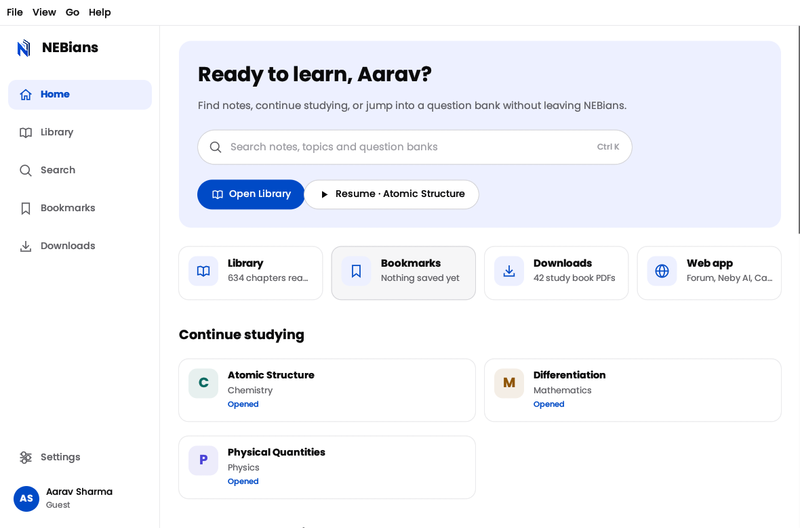

# NEBians Desktop

A native desktop app for the NEBians open-learning platform, written in **Rust** with **egui/eframe** (OpenGL, no webview, no Electron). Material 3 Expressive look matching the Android app; **real accounts** (Google, GitHub, email — same backend as Android); live Community, Notifications and profile sync; offline study content from this repo.

**Backend change to deploy:** `backend_python` gained a browser hand-off sign-in for desktop — see [docs/BACKEND.md](docs/BACKEND.md). Point the app at any deployment with `NEB_API_BASE=https://host/`.

| | |
|---|---|
| Run from a checkout | `cd desktop && cargo run --release` (finds `../backend_python/web/data` automatically) |
| Build | `cd desktop && cargo build --release` → `target/release/nebians` |
| Windows `.exe` | `scripts/build.sh windows` (mingw cross-compile) or CI `.github/workflows/desktop-windows.yml` — see [docs/BUILD.md](docs/BUILD.md) |
| Redistributable folder | `scripts/bundle-content.sh [linux\|windows]` → `dist/NEBians-Desktop-*.zip` |
| Screenshots | `scripts/screenshots.sh` (headless tour; 31 images in [screenshots/](screenshots)) |

## Where everything is
- **Source:** [`src/`](src) — `main.rs` (entry), `app.rs` (state + routing + shortcuts), `screens/` (one file per screen), `ui/` (widgets, nav, menu, icons), `theme/`, `data/`, `reader/` (HTML→native renderer, LaTeX typesetter)
- **Assets:** [`assets/`](assets) (Poppins incl. Devanagari, logo, ico)
- **Docs:** [BACKEND](docs/BACKEND.md) · [ENV](docs/ENV.md) · [PARITY](docs/PARITY.md) · [DESIGN](docs/DESIGN.md) · [ARCHITECTURE](docs/ARCHITECTURE.md) · [BUILD](docs/BUILD.md) · [CHANGELOG](docs/CHANGELOG.md) · [LIMITATIONS](docs/LIMITATIONS.md)
- **Scripts:** [`scripts/`](scripts) · **Screenshots:** [`screenshots/`](screenshots)

## Flags
`--content <dir>` (NEB checkout or bundled `content/`), `--config <dir>`, `--reset`, `--screenshots <dir>`, `--version`.

## Keyboard
Ctrl+K search · Ctrl+1…6 sections (Home, Library, Community, Notifications, Bookmarks, Downloads) · Ctrl+, settings · Esc back · Alt+←/→ · Ctrl+B bookmark · Ctrl+D dark · Ctrl +/−/0 zoom · `[` `]` prev/next chapter · Space/PgDn scroll · T contents · F11 · F1 help.
